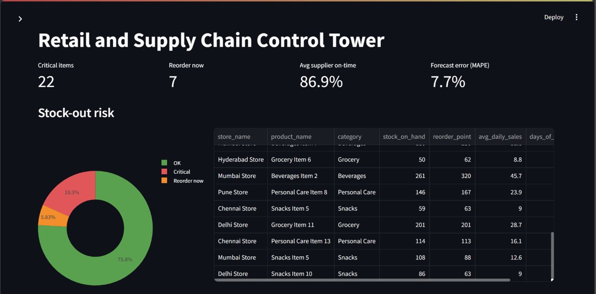
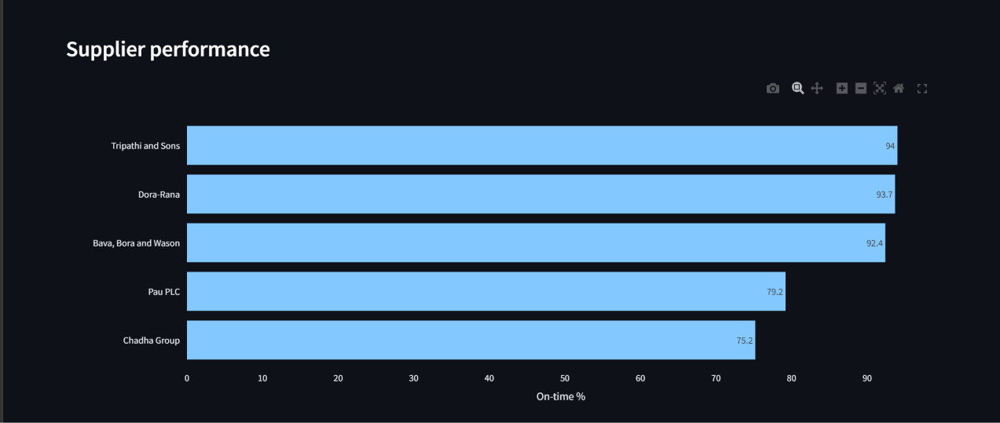
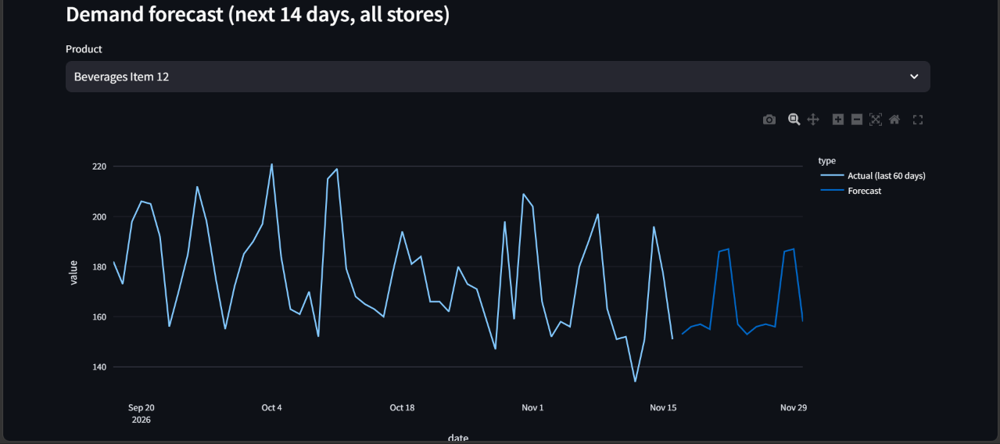

# DA-03: Retail and Supply Chain Control Tower

A near real-time view of inventory, deliveries and suppliers that warns about stock-out problems before they hurt sales. It generates synthetic retail data, stores it in SQLite, scores stock-out risk and supplier performance with SQL, forecasts demand with Prophet, and shows everything in a Streamlit dashboard with email and Slack alerts.

## Architecture

```
generate_data.py -> load_db.py -> run_queries.py -> forecast.py -> alerts.py
   (CSV files)       (SQLite)      (SQL -> CSV)      (Prophet)     (email/Slack)
                                         |
                              dashboard/app.py (Streamlit)
```

| Step | Script | Output |
|------|--------|--------|
| 1. Synthetic data | `src/generate_data.py` | 6 CSVs in `data/raw/` |
| 2. Database | `src/load_db.py` | `data/processed/retail.db` (SQLite) |
| 3. SQL analytics | `src/run_queries.py` + `sql/*.sql` | `reports/stockout_risk.csv`, `reports/supplier_performance.csv` |
| 4. Demand forecast | `src/forecast.py` | `forecast` table, `reports/forecast.csv`, `reports/forecast_accuracy.csv` |
| 5. Alerts | `src/alerts.py` | Printed alert, optional email and Slack |
| Dashboard | `dashboard/app.py` | Streamlit app |
| Scheduling | `dags/control_tower_dag.py` | Airflow DAG definition |
| Orchestration | `src/run_pipeline.py` | Runs steps 1 to 5 |

## Tools and substitutions

| Brief | Used here | Why |
|-------|-----------|-----|
| Apache Superset | Streamlit | Runs locally with one command and needs no Docker |
| PostgreSQL | SQLite | Zero setup. The SQL is standard and ports to PostgreSQL with minor changes (date functions) |
| Airflow | DAG file in `dags/`, plus `run_pipeline.py` | Airflow does not run natively on Windows. The DAG is provided for a Linux or Docker deployment and was not executed in this repo |
| Prophet | Prophet | Used as specified |
| Slack/Email alerts | `src/alerts.py` | Python SMTP and Slack webhook |

## Setup

```
git clone https://github.com/Sricharan927/da03-retail-supply-chain.git
cd da03-retail-supply-chain
python -m venv venv
venv\Scripts\Activate.ps1
pip install -r requirements.txt
python src/run_pipeline.py
streamlit run dashboard/app.py
```

## Data

All data is synthetic and seeded. It covers 6 stores, 20 products, 5 suppliers, 730 days of daily sales (87,600 rows), current inventory for every store and product (120 lines) and 600 supplier deliveries, some of them late. Stock levels are set between 1 and 25 days of cover, so about a fifth of lines are at risk.

## How stock-out risk is scored

Days of cover is stock on hand divided by average daily sales over the last 28 days.

- **Critical:** days of cover is below the supplier's lead time, so stock runs out before a new delivery can arrive.
- **Reorder now:** stock is at or below the reorder point (7 days of sales).
- **OK:** everything else.

Result: 22 Critical, 7 Reorder now and 91 OK out of 120 lines.

## Supplier performance

On-time rate, average delay and actual lead time per supplier. Chadha Group (75.2%) and Pau PLC (79.2%) fall below the 80% alert threshold.

## Demand forecast

Prophet models weekly and yearly seasonality per product, forecasting 14 days ahead across all stores. The last 14 days are held out to measure accuracy honestly: **average MAPE is 7.7%**, ranging from 4.4% to 12.8% by product. Prophet warns that yearly seasonality is fitted on under two years of history, which is acceptable for this synthetic data but would need more history in production.

## Dashboard





KPI tiles, a stock-out risk donut and table filterable by store and category, a supplier performance chart and a forecast chart per product.

## Alerts

`python src/alerts.py` prints the critical items and weak suppliers. It also sends an email if `SMTP_USER`, `SMTP_APP_PASSWORD` and `EMAIL_TO` are set, and a Slack message if `SLACK_WEBHOOK_URL` is set. Credentials are read from environment variables and never stored in the repo.

## Testing

```
python -m pytest tests -v
```

Eight tests check row counts, supplier coverage, no negative sales or stock, deliveries not before orders, valid risk statuses, that Critical lines have cover below lead time, forecast completeness (20 products x 14 days) and a forecast error ceiling.